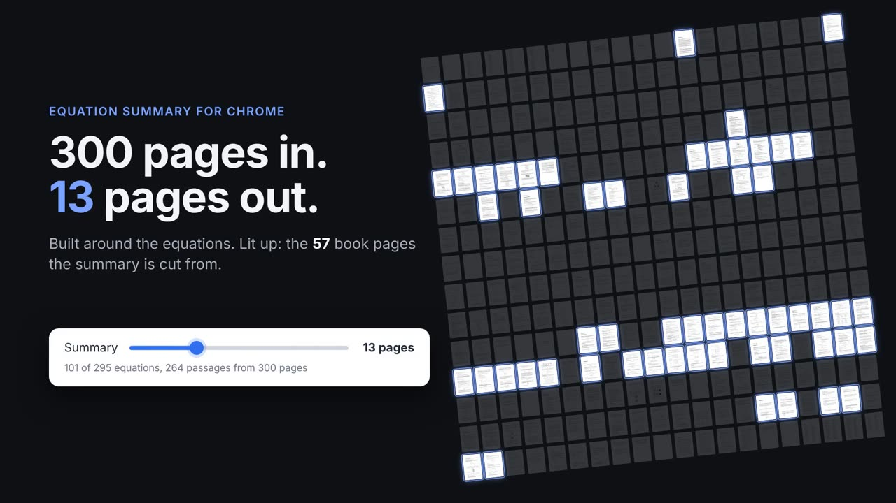
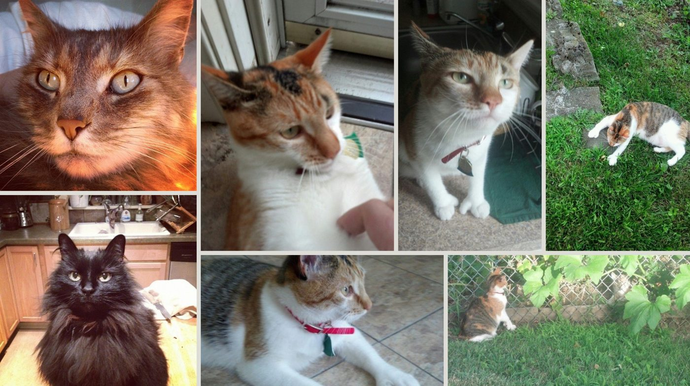
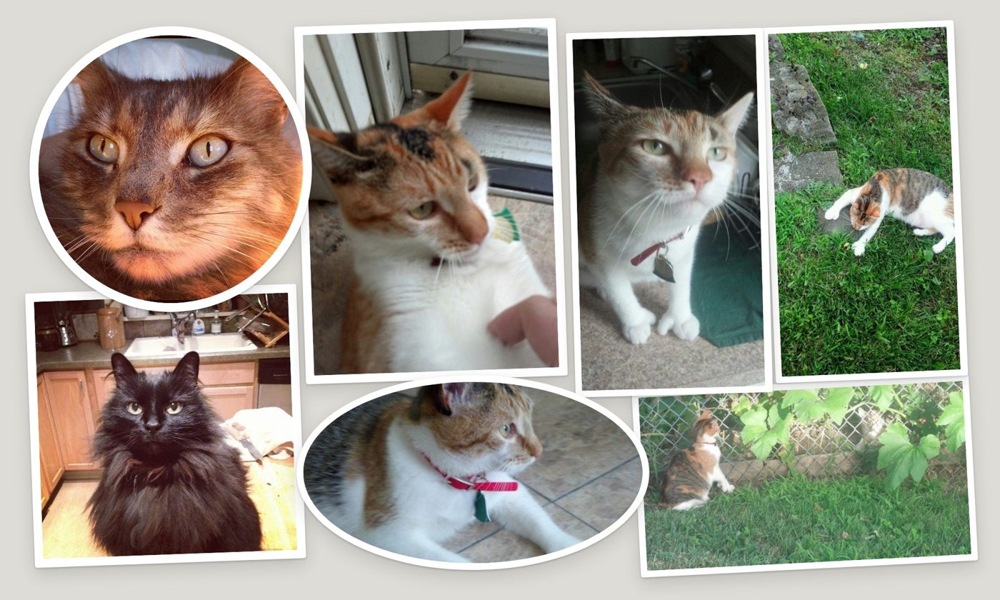

# dyna-js

Three things in one repository, each built on the one below it:

- **[Equation Summary](#equation-summary):** any typeset math PDF, summarised to any number of pages, keeping its equations.
- **[Collage](#collage):** a gap-free photo collage for 1 to 9 photos that re-lays itself instantly at any size.
- **[dyna](#dyna):** the small solver library both are built on.

## Equation Summary

A 300-page math book, summarised to 12 pages, or any length you drag the slider to. Every page of the summary is cut from the book itself, so the mathematics is as sharp as the original and the text can still be selected and searched. It all runs in the browser; the PDF is never uploaded.

[](https://www.youtube.com/watch?v=uE2RSIX7nrA)

▶ [Watch the 30-second video on YouTube](https://www.youtube.com/watch?v=uE2RSIX7nrA)

| | |
| --- | --- |
| [Chrome extension](chrome-eqsum) | Click the toolbar button on any PDF open in Chrome, or right-click a link to one. |
| [`@vhalaharvi/react-eqsum`](packages/react-eqsum) | `<EquationSummary>`: the viewer as a React component, with the slider and Download PDF. |
| [`@vhalaharvi/eqsum`](packages/eqsum) | The engine, framework-free: reads the PDF, chooses what goes in, lays out the pages. |
| [Demo](demo-eqsum) | A page you can run locally on your own book. |

```sh
npm install @vhalaharvi/react-eqsum pdfjs-dist
```

## Collage

Every photo keeps its shape, there are no gaps, and very little is cropped.





Resizing is a lookup, not a new solve:


Photos: [max-mapper/cats](https://github.com/max-mapper/cats), BSD licensed ([credits](docs/CATS.md)).

| | |
| --- | --- |
| [`@vhalaharvi/react-collage`](packages/react-collage) | `<CollageAlbum>`: the collage as a React component, in a grid or scrapbook style. |
| [`@vhalaharvi/collage`](packages/collage) | The layouts, framework-free: every guillotine layout of up to 9 photos, solved once and indexed by aspect ratio. |

```sh
npm install @vhalaharvi/react-collage
```

```tsx
import { CollageAlbum } from "@vhalaharvi/react-collage";

<CollageAlbum
  aspect={16 / 9}
  photos={[
    { src: "/a.jpg", width: 1200, height: 800 },
    { src: "/b.jpg", width: 800, height: 1200, shape: "round" },
    { src: "/c.jpg", width: 1000, height: 1000 },
  ]}
/>;
```

## dyna

[`@vhalaharvi/dyna`](packages/dyna) is the core both are built on: dynamic programming as recursion schemes over semirings, in TypeScript, with no dependencies. Describe a problem as a coalgebra (how a state splits) and an algebra over a semiring (how answers combine); `dyna` memoises and folds it.

## How it is checked

- `collage` is compared with the Go engine at
  [github.com/vinodhalaharvi/collage](https://github.com/vinodhalaharvi/collage):
  `fixtures/gen` writes the Go answers for 34 photo sets of 1 to 9 photos at six
  canvas shapes, and the tests require the same counts, the same top five
  layouts and the same scores to 1e-12.
- Every algebra is property-tested against the semiring laws `dyna` relies on,
  and `dyna` is compared with brute force (fold every solution separately).
- The component is tested on the server and in a DOM: every photo appears
  once, cells tile the canvas without overlap, and placements stay put across
  sizes.

## Develop

```sh
npm install
npm test           # vitest
npm run typecheck  # tsc -b
```

To refresh the Go reference answers (needs Go):
`cd fixtures/gen && go run . > ../collage.json`.

## License

MIT
