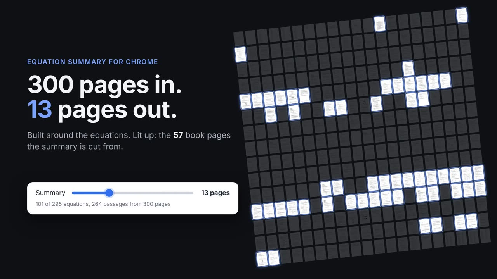

# Equation Summary for Chrome

Summarise any typeset math PDF you find online (a book, lecture notes, a paper) to any number of
pages, keeping its equations and the text around them. It's [react-eqsum](../packages/react-eqsum)
in a Chrome extension.

[](https://www.youtube.com/watch?v=uE2RSIX7nrA)

▶ [Watch the 30-second video on YouTube](https://www.youtube.com/watch?v=uE2RSIX7nrA)

- **On a PDF open in Chrome:** click the toolbar button.
- **On a link to a PDF:** right-click it and choose **Summarise this PDF**.
- **A file on your computer:** drop it on the extension's page, or turn on *Allow access to file
  URLs* for the extension in `chrome://extensions`.

The first time you summarise a PDF from a site, the extension asks for access to that site (and
only that site), because that's what lets it read the file. Everything else happens in your browser.
Nothing is uploaded, and there are no accounts, analytics or remote code.

Typeset PDFs only: a scanned book has no text to read, and a book behind a sign-in or a DRM reader
can only be used once you've downloaded the PDF.

## Build

```sh
npm ci && npm run build
sh chrome-eqsum/build.sh      # dist/ to load unpacked, equation-summary.zip for the Chrome Web Store
```

To try it: open `chrome://extensions`, turn on *Developer mode*, choose **Load unpacked** and pick
`chrome-eqsum/dist`.

## Chrome Web Store listing

- **Name:** Equation Summary
- **Summary:** Summarise a typeset math PDF to any number of pages, keeping its equations.
- **Category:** Education
- **Single purpose:** Summarise a PDF the user chooses into a shorter PDF view that keeps its equations.
- **Permissions:** *activeTab*, so the toolbar button can read the address of the PDF it was
  clicked on. *contextMenus*, for "Summarise this PDF" on PDF links. *Optional host access*,
  requested for one site at a time when the user summarises a PDF from it, to read that PDF.
- **Data use:** no user data is collected, sent or sold. The PDF is read and summarised in the browser.
