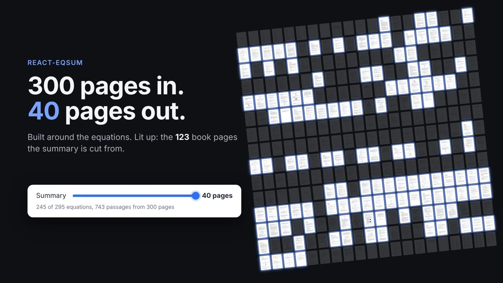

# react-eqsum demo

A 300-page math book cut down to a summary of 1 to 40 pages that is built around its equations, or to every equation with its text (**All pages**). Equations count most, the sentences around them next, and other prose least.

[](media/eqsum-demo.mp4)

▶ [Watch the 36-second demo](media/eqsum-demo.mp4) (MP4, 1080p, no sound)

What the video shows:

- **Drag for a shorter or longer summary.** The slider goes from 1 to 40 pages, and the summary and its counts follow at once.
- **Every page is cut from the book itself.** Nothing is re-typed, so the fonts and the mathematics look exactly as they do in the book.
- **It stays real text.** You can select it, copy it and search it.
- **Click a p. N** to open the full book at the page that passage came from.

Everything runs in the browser. The PDF is never uploaded.

## Run it

```sh
npm ci
npm run build
BOOK=path/to/book.pdf sh demo-eqsum/build.sh
cd demo-eqsum/dist && python3 -m http.server 8000
```

Then open http://localhost:8000. Use **Open your own typeset PDF** to try another book.

The page is [`main.tsx`](main.tsx). It is the `<EquationSummary>` component from [`@vhalaharvi/react-eqsum`](../packages/react-eqsum) with the solver in a Web Worker:

```tsx
<EquationSummary
  pdfjs={pdfjs}
  source="book.pdf"
  defaultPages={12}
  maxPages={40}
  worker={() => new Worker("eqsum-worker.js", { type: "module" })}
/>
```

## The book

The video uses [*Competitive Programmer’s Handbook*](https://github.com/pllk/cphb) by Antti Laaksonen, under CC BY-NC-SA 4.0. It has 300 pages and 295 displayed equations.
