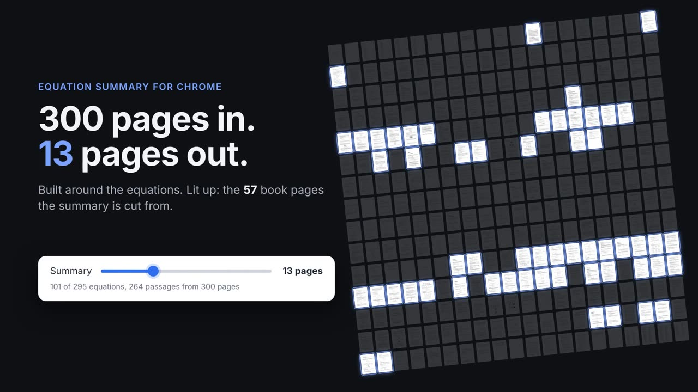

# @vhalaharvi/eqsum

Summaries of typeset (LaTeX) books that keep the equations. Give it a PDF and a length; it picks
what goes in, with equations counting most, the text around them next and other prose least, and
lays it out on pages. Nothing is re-typed: the summary is made of regions of the source pages.

[](https://www.youtube.com/watch?v=uE2RSIX7nrA)

▶ [Watch the 30-second video on YouTube](https://www.youtube.com/watch?v=uE2RSIX7nrA)

```ts
import * as pdfjs from "pdfjs-dist";
import { readBook } from "@vhalaharvi/eqsum";

const doc = await pdfjs.getDocument({ url: "book.pdf", fontExtraProperties: true }).promise;
const book = await readBook(doc, pdfjs.OPS); // every length, up to the whole book
const s = book.summary(20); // pages of { page, clip, at }: draw each clip of its source page at `at`
```

**As a PDF.** `@vhalaharvi/eqsum/export` (with [pdf-lib](https://pdf-lib.js.org)) turns a summary
into a PDF file. Each passage is its source page, clipped and placed, not a picture of it. The text
outside each passage is removed from its copy of the page, so the file's text is what it shows.

```ts
import { summaryPdf } from "@vhalaharvi/eqsum/export";
const bytes = await summaryPdf(pdfBytes, s.pages, { width: book.width, height: book.height });
```

**What matters most.** An equation the rest of the book relies on is worth more. Three kinds of
link are read:
- references to numbered equations: "(3.2)", "equation 3.2", "eq. (3.2)", and 式(3.2) in Chinese;
- citations of numbered results: "by Theorem 4.1" points to the equations stated in it;
- uses of symbols: an equation that begins by defining something (`f(n) = …`, `A := …`,
  `ρ : G → V`) is linked from the later equations that use it. A function or a longer name holds
  for its chapter, and a single letter only for its section. The rarer the symbol, the stronger
  the link.

Importance flows along the links as in PageRank, restarting in proportion to what each unit is
worth on its own. An equation nothing refers to keeps its worth, and one much relied on gains, on
a log scale up to 4×. On the test books, a 12-page summary leaves far fewer symbols without the
equation that defines them (on the demo book, 68% → 9%). `book.links` and `book.importance` show
what was found.

**How it chooses.** The book is read into units (display equations, paragraphs, code, figures and
headings) from its fonts and layout. Then a knapsack over page height is solved with
[@vhalaharvi/dyna](../dyna) at two levels: each section's best value at every height, then the
book's chapters and sections over those. Because the book level is graded by height, **one solve
answers every length**, up to the whole book or 100 pages (`MAX_PAGES`), so `summary(n)` is a
lookup. Time and memory grow with that length (a dense 417-page book: about 37 s and 0.9 GB to 100
pages, 135 s and 1.8 GB to all of it); `maxPages` sets it higher or lower. Rules that keep it readable:
- Text near an equation counts only with its equation.
- An equation shown with none of its text is worth less.
- Each further equation in a section is worth a little less, which spreads the summary across the book.
- Worked examples in numbers count for half a general formula.
- A heading's height counts only when something under it is chosen.

All of these are `weights`, as is how much the links count (`weights.links`: 1, or 0 to ignore them).

Tested against dyna's `bruteForce` on every section small enough to enumerate. Typeset PDFs only:
a scanned book has no fonts to read.
